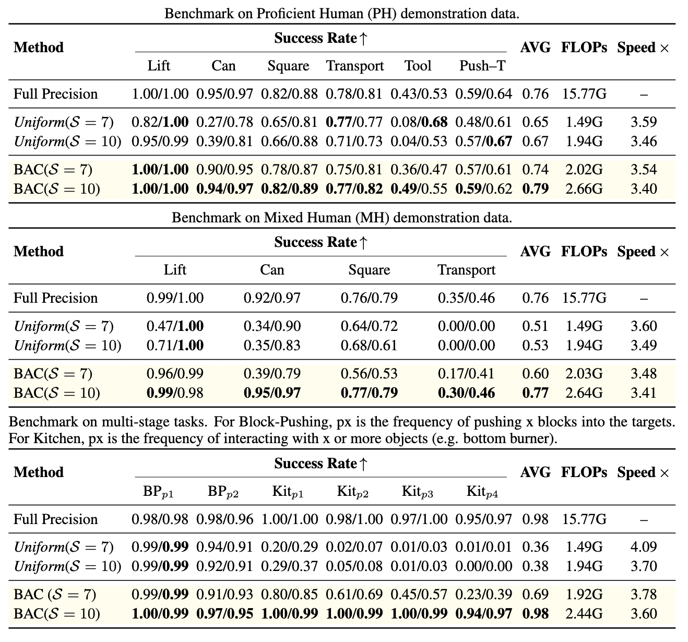

# Block-wise Adaptive Caching for Diffusion Policy

<div align="center">

### 🚀 An Efficient Acceleration Technique for Transformer-based Diffusion Policies

[](https://arxiv.org/pdf/2506.13456)
[](https://block-wise-adaptive-caching.github.io/)
[](https://github.com/ky-ji/BAC.git)
[](https://opensource.org/licenses/MIT)
[](https://iclr.cc/)

**ICLR 2026**

[Paper](https://arxiv.org/pdf/2506.13456) | [Project Page](https://block-wise-adaptive-caching.github.io/) | [Code](https://github.com/ky-ji/BAC.git)

</div>

---

## 📋 Overview

<div align="center">
  
</div>

**BAC (Block-wise Adaptive Caching)** is a novel acceleration technique designed specifically for Transformer-based Diffusion Policies in robotic manipulation tasks. Our method achieves significant speedup while maintaining high task success rates.

### ✨ Key Features

- **🔧 Adaptive Caching Scheduler (ACS)**: Dynamically determines optimal cache update steps for each transformer block based on temporal activation similarity analysis
- **🫧 Bubbling Union (BU) Algorithm**: Propagates cache schedules from downsteam rFFN blocks to upstream blocks to mitigate the error surge phenomenon
- **⚡ Significant Speedup**: Achieves up to **3x** lossless acceleration
- **🔌 Plug-and-Play**: Easy to integrate with existing Diffusion Policy implementations

---

## 🛠️ Installation

### Prerequisites

- Python 3.9
- CUDA 11.6 or higher
- Conda package manager

### Setup Environment

```bash
git clone https://github.com/ky-ji/BAC.git
cd BAC

conda env create -f conda_environment.yaml
conda activate robodiff

pip install -e .
```

---

## 🚀 Quick Start

### 1. Prepare Data and Checkpoints

This implementation works with checkpoints from the [Diffusion Policy](https://diffusion-policy.cs.columbia.edu/) project. Please refer to the original project for dataset downloads and model training.

### 2. Compute Optimal Cache Schedules

Before running accelerated inference, compute the optimal caching schedules using our **Adaptive Caching Scheduler (ACS)**:

```bash
# For a single task
python -m BACInfer.analysis.get_optimal_cache_update_steps \
  -c <checkpoint_path> \
  -o <output_dir> \
  -d cuda:0 \
  --num_caches 5,8,10,20 \
  --force_recompute

# Batch process all tasks
bash BACInfer/shell/get_steps/get_optimal_steps.sh --device cuda:0 --num_caches 5
```

### 3. Run Evaluation

Evaluate the policy with BAC acceleration:

```bash
# With BAC (optimal caching + BU algorithm)
python -m BACInfer.scripts.eval_fast_diffusion_policy \
  --checkpoint <checkpoint_path> \
  -o <output_dir> \
  --device cuda:0 \
  --cache_mode optimal \
  --optimal_steps_dir <optimal_steps_dir> \
  --metric cosine \
  --num_caches 5 \
  --num_bu_blocks 3 \
  --skip_video

# No caching
python -m BACInfer.scripts.eval_fast_diffusion_policy \
  --checkpoint <checkpoint_path> \
  -o <output_dir> \
  --device cuda:0 \
  --cache_mode original \
  --skip_video

# Uniform caching 
python -m BACInfer.scripts.eval_fast_diffusion_policy \
  --checkpoint <checkpoint_path> \
  -o <output_dir> \
  --device cuda:0 \
  --cache_mode threshold \
  --cache_threshold 5 \
  --skip_video
```

### 4. Run Full Benchmarks

Run comprehensive benchmarks across all tasks:

```bash
# Run BAC benchmarks
bash BACInfer/shell/main/run_bac_all.sh --device cuda:0 --steps 5 --metric cosine
```

---


## 🤖 Real Robot Deployment

BAC can be deployed for real-time robot inference. The `realworld/` directory contains inference servers optimized for real robot control.

### Quick Start

```bash
cd realworld

# Run original inference server
python inference_server.py

# Run BAC accelerated inference server
python inference_server_bac.py
```

### Configuration

Edit `realworld/server_config.py` to configure BAC settings:

```python
ENABLE_BAC = True
CACHE_MODE = 'optimal'  # or 'threshold'
NUM_CACHES = 5
NUM_BU_BLOCKS = 3
OPTIMAL_STEPS_DIR = None  # auto-find or specify path
```

### Collect Optimal Steps for Real Robot

Before deploying BAC on the real robot, collect optimal cache schedules:

```bash
cd realworld

# Collect activations at iteration 10
python inference_server_analyze.py --iteration 10 --num_bu_blocks 3

```

### Real Robot Inference Files

- `inference_server.py` - Original inference server
- `inference_server_bac.py` - BAC accelerated inference server
- `inference_server_analyze.py` - Activation collection server
- `bac_policy_wrapper.py` - BAC policy wrapper
- `bac_realworld_analyzer.py` - Optimal steps computation
- `server_config.py` - Server configuration


## 📊 Performance

<div align="center">
  
</div>

BAC achieves significant speedup while maintaining competitive task success rates across various robotic manipulation benchmarks.

---

## 📁 Project Structure

```
BAC/
├── BACInfer/                      # BAC acceleration module
│   ├── core/                      # Core caching wrapper (FastDiffusionPolicy)
│   ├── analysis/                  # Activation analysis and optimal schedule computation
│   ├── scripts/                   # Evaluation scripts
│   └── shell/                     # Shell scripts for batch experiments
├── diffusion_policy/              # Base diffusion policy implementation
│   ├── model/                     # Transformer and diffusion model architectures
│   ├── env/                       # Simulation environments
│   ├── env_runner/                # Environment runners
│   └── workspace/                 # Training workspace
├── checkpoint/                    # Model checkpoints (not included)
├── data/                          # Training datasets (not included)
├── assets/                        # Cached activations and optimal schedules
│   └── {task}/
│       └── optimal_steps/         # Per-module optimal cache schedules
└── results/                       # Evaluation results
```

---

## 📝 Citation

If you find BAC useful for your research, please consider citing our paper:

```bibtex
@article{ji2025block,
  title={Block-wise Adaptive Caching for Accelerating Diffusion Policy},
  author={Ji, Kangye and Meng, Yuan and Cui, Hanyun and Li, Ye and Hua, Shengjia and Chen, Lei and Wang, Zhi},
  journal={arXiv preprint arXiv:2506.13456},
  year={2025}
}
```

---

## ❤️ Acknowledgments

This work builds upon:
- [Diffusion Policy](https://github.com/real-stanford/diffusion_policy) - Original diffusion policy implementation
- [robomimic](https://github.com/ARISE-Initiative/robomimic) - Robot learning framework and benchmarks

We sincerely thank the authors of these projects for their open-source contributions!

---

## 🌟 Star History

<div align="center">

[](https://star-history.com/#ky-ji/BAC&Date)

</div>

---

## 📄 License

This project is licensed under the MIT License - see the [LICENSE](LICENSE) file for details.

---

<div align="center">

**If you have any questions, please feel free to open an issue!**

</div>
