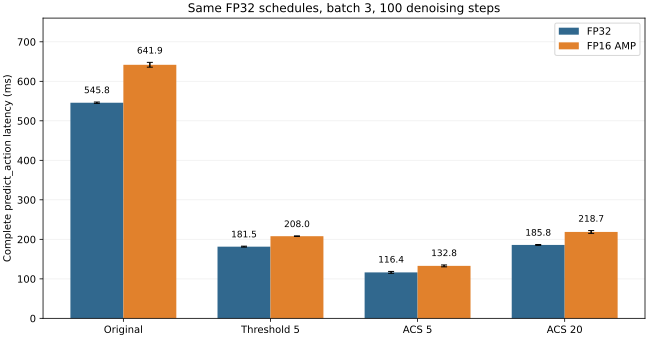
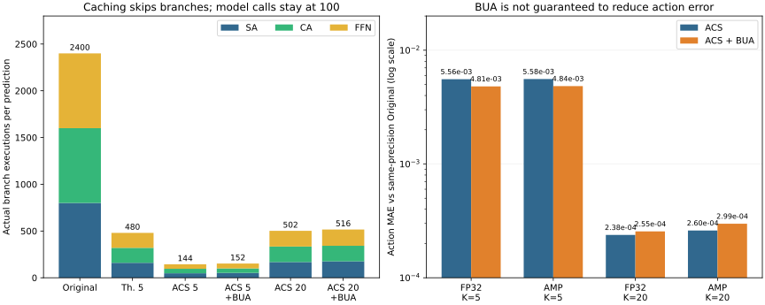

# BAC Lowdim Transformer FP16 最终实验报告

本报告解释实验指标、实际结果、源码修改与复现方法，面向正在学习 Python / PyTorch 的项目使用者。

## 先用通俗的话说：我们到底做了什么实验

**我们拿同一个已经训练好的推方块模型，研究“怎样让它更快地算出动作，同时尽量保持原来的表现”。** 这次做的是推理实验，也就是让已有模型使用起来更快。

这个模型一次算出动作，需要在内部反复修正 100 轮。你可以把它理解为：先有一份粗略动作草稿，再一轮轮修改，最后得到要执行的动作。模型里面还有几类负责不同工作的计算模块。

我们比较了以下几种做法：

| 做法 | 用日常语言理解 | 想回答的问题 |
|---|---|---|
| 原来的 FP32 | 用原来的数字精度，每轮完整计算 | 原本要多久？作为所有比较的起点 |
| FP16 AMP | 一部分计算改用精度较低的数字，仍然做 100 轮 | 数字精度降低后，会不会更快？动作会变化多少？ |
| 固定间隔缓存 | 中间模块每隔几轮重新算一次，其他轮沿用旧结果 | 最简单的“少重算”有没有效果？ |
| ACS 缓存 | 先观察中间结果怎样变化，再为不同模块安排各自的重算时机 | 能不能比固定间隔更合理地省计算？ |
| ACS 加 BUA | 在 ACS 基础上，给某些模块补上额外重算 | 多花一点计算，能不能减少动作变化？ |

这里最容易误解的是“少算”：**缓存版本仍然修正 100 轮，只是在每轮内部少重算一些模块。** ACS20 表示给每个模块安排约 20 次重新计算的机会，不是把整个过程从 100 轮改成 20 轮；末轮刷新和 BUA 还会增加实际次数。

实验分三件事来检查：

1. **看动作变了多少。** 给各版本完全相同的观测和随机起点，把它们算出的动作与原版比较。这是在看数值变化，不是在算任务失败率。
2. **看用了多久。** 先让模型预热，然后每个版本测量 10 次。这里一次是同时处理 3 个输入，包含完整 100 轮修正。
3. **真的去推方块。** 让模型执行动作，环境发生变化，再继续预测下一步。每个参与任务评估的版本都用了相同的 3 个环境初始设置。

当前这轮最值得先看的四个结果：

| 版本 | 一次计算平均耗时 | 直观理解 |
|---|---:|---|
| 原版 FP32 | 约 546 毫秒 | 比较起点 |
| 只改 FP16 | 约 642 毫秒 | 本机反而慢了一些 |
| FP32 + ACS20 缓存 | 约 186 毫秒 | 速度约为原版的 2.94 倍 |
| FP16 + ACS20 缓存，使用 FP32 调度 | 约 219 毫秒 | 速度约为原版的 2.50 倍，主要收益来自缓存 |

换句话说，本轮最明确的发现是：**避免反复重算中间结果很有效；把数字精度降低，并没有在这台电脑和这个模型上额外提速。**

“动作变了多少”和“任务完成了没有”要分开看。模型算出的动作可以有一点不同，但仍然把方块推到目标位置。本轮真正运行任务的 8 个版本，各自都在 3 个测试任务中完成了任务；不过测试还少，暂时只能说明这几个例子通过。

我在程序中做的事，主要是加上 FP16 开关、接通两种精度下的缓存实验、修正会影响实验运行的问题，并增加自动测量和记录。你在这里看到的报告整理读取已有实验数据，不会再次运行机械臂任务或改动模型。

如果只想先理解实验，读到这里即可。后面的内容解释每个数字怎么得到、源码改在哪里，以及怎样重新运行。

## 1. 本报告采用哪一轮数据

本报告以当前 [summary.json](lowdim_fp16/summary.json) 为唯一数值来源，并已核对它与本机 `results/lowdim_fp16_my_run/summary.json` 完全相同。此前交付文档中的约 557 / 655 / 224 ms 来自另一轮计时；本轮对应值为 **545.84 / 641.86 / 218.66 ms**，两轮数据不能拼成一张对比表。

| 项目 | 本轮设置 |
|---|---|
| 项目与分支 | BAC，`feature/lowdim_fp16` |
| 源码基线 | 生成本报告前的 HEAD：`3a11808`；本轮分析未修改模型或缓存算法 |
| 原始结果目录 | `results/lowdim_fp16_my_run/` |
| GPU | NVIDIA GeForce RTX 5070 Ti Laptop GPU |
| PyTorch | `2.11.0+cu128`；沿用 `bac` 环境 |
| 模型权重 | 同一 checkpoint 的 `workspace.model`，所有组一致；未混用 EMA |
| Transformer | 8 个 Decoder layers，4 个 heads，embedding 256，输入 / 输出动作维度 2 |
| 输入观测 | `[3, 3, 16]` = batch 3 × 历史观测长度 3 × 每帧 16 维 |
| 预测动作 | `action_pred=[3,5,2]`，实际返回执行的 `action=[3,1,2]` |
| 去噪步数 | 每次 `predict_action()` 均为 100 步 |
| 校准数据 | 环境 seed 0 的一个初始观测窗口，噪声 seed 11，batch 1 |
| 数值验证 | 环境 seeds 10000 / 10001 / 10002，噪声 seeds 101 / 102 / 103 |
| 计时 | 每模式预热 3 次，测量 10 次，计时前后同步 CUDA；batch 3 |
| 闭环评估 | 8 种模式，每种相同 3 个环境 seeds；每 episode 最多 350 个环境步 |
| 执行配置 | `torch_num_threads=1`；CUDA matmul 的 TF32 开关为 false，cuDNN 的为 true |
| BUA | 从各自校准特征选排名最高的 3 个分支 |

Checkpoint：`checkpoint/low_dim/block_pushing/diffusion_policy_transformer/train_0/checkpoints/epoch=7550-test_mean_score=1.000.ckpt`。

Checkpoint SHA-256：`0673d771bc652a61f97068935f51f862a731e82197613d9d02e1b500b7803f29`。

本轮 summary SHA-256：`7d274b1273b8f7f30173c78bbad6ea1f9993a67e664f551e9e9f1e4d7af4b98c`。SHA-256 是内容指纹，用于确认比较的是同一份文件。

这里的“历史观测长度 3”在固定输入验证时，是把环境重置后的同一帧重复 3 次，构造初始窗口，并非从轨迹中抽取三个不同时刻。闭环运行后才逐步更新真实历史。三个噪声 seeds 各对 batch 中三个环境初始观测生成动作，共 9 组固定观测 / 噪声组合；这不等于跑了 9 个完整任务。

## 2. 结果先说明了什么

1. **FP16 AMP 路径已跑通且输出有限，但单独使用在本机更慢。** Original 从 545.84 ms 增加到 641.86 ms，耗时增加约 17.59%；action MAE 仅约 `6.59e-6`。
2. **主要加速来自缓存减少分支重算。** FP16 + ACS20、使用 FP32 调度为 218.66 ms，相对 FP32 Original 加速 2.496 倍、耗时减少约 59.94%。
3. **本轮 FP32 缓存也很有效。** FP32 + ACS20 为 185.79 ms、加速 2.938 倍，比对应 FP16 配置更快。当前数据不能支持“FP16 比 FP32 快”的结论。
4. **更少更新意味着更强近似。** ACS5 很快，但误差明显大于 ACS20，且未进行闭环评估。
5. **BUA 与 FP16 专用调度的作用要逐项判断。** 它们确实执行了，但不保证每一组误差都下降、速度都提高。
6. **已做真实闭环验证，但规模较小。** 已评估的 8 种模式各 3 个 episodes，得分均为 `[1,1,1]`。这支持这些样本上的任务完成情况，不能推出普遍无损或论文规模的成功率复现。

## 3. 每个模式名称是什么意思

例如 `fp16_amp_acs20_fp32_bua` 可以拆成：

```text
fp16_amp  +  acs20  +  fp32  +  bua
运行精度     更新预算    调度来源    开启 BUA
```

| 名称 | 实际含义 |
|---|---|
| `fp32` | 正常 FP32 推理路径，作为主要基准 |
| `fp16_amp` | 自动混合精度；仅 Transformer forward 启用 FP16 autocast |
| `original` | 不启用 BAC 缓存，每个去噪步都重算全部分支 |
| `threshold1` | 固定间隔为 1，每步更新，不减少分支重算；用于正确性与包装开销对照 |
| `threshold5` | 每隔 5 个执行步更新，其余步复用该分支缓存 |
| `acs5` / `acs20` | 为每个分支离线选择 5 / 20 个更新时间点；在线还可能加入末步与 BUA 点 |
| ACS 后的 `fp32` | 调度由 FP32 Original 特征生成；运行本身仍可为 AMP |
| ACS 后的 `fp16_amp` | 调度由真正经过 AMP 的 Original 特征生成 |
| `_bua` | 在原 ACS 调度上应用 Bubbling Union Algorithm，增加部分更新点 |

“预算 20”针对每个 SA / CA / FFN 分支，并不是整个 Transformer 只调用 20 次，也不是只使用 20 个去噪步。本轮为 2 种 Original、4 种 Threshold、2 个 ACS 预算 × 3 种精度 / 调度组合 × 2 种 BUA 状态，共 18 种模式。

## 4. 性能指标怎么读

### 4.1 mean、std、p50

`mean_ms` 是 10 次完整 `predict_action()` 耗时的平均值，越小越快。它包含归一化、100 次去噪循环、模型执行、Scheduler 更新和返回 GPU 动作张量；不含离线校准、环境 `step()`、动作复制到 CPU、视频保存及观察 hook 的开销。

`std_ms` 是 10 次耗时的标准差，当前代码使用 `np.std(..., ddof=0)`。越小表示这 10 次测量越集中；“mean ± std”不是置信区间，也不是最快 / 最慢耗时。

`p50_ms` 是中位数。例如 10 个耗时排序后取中间两个值的平均。它有助于观察个别慢样本是否明显拉高均值。原始 10 个值保存在 `samples_ms` 中。

CUDA 运算异步提交，所以计时前后调用 `torch.cuda.synchronize()`，等待 GPU 完成工作。预热不计入统计。这里测的是主机观察到的完整推理延迟，不是纯 GPU kernel 时间。

**batch 3 的 218.66 ms 不能直接除以 3，当成单环境的响应延迟。** 除法得到的只是按样本摊分耗时；batch 1 的实际延迟需要单独测量。模拟环境设置的 10 Hz 也不代表该推理程序已达到真实时间控制的 10 Hz。

### 4.2 两种 speedup

```text
相对 FP32 Original 加速比 = FP32 Original 平均耗时 / 当前模式平均耗时
相对同精度 Original 加速比 = 当前运行精度的 Original 平均耗时 / 当前模式平均耗时
耗时减少比例 = 1 - 当前耗时 / 基准耗时
```

以 `fp16_amp_acs20_fp32` 为例：

- `545.8449 / 218.6550 = 2.496`：精度切换与缓存组合后，相对 FP32 Original 的总效果。
- `641.8630 / 218.6550 = 2.936`：在 AMP 模式内部，添加缓存的效果。
- 耗时减少约 59.94%，不能把“2.496 倍加速”写成“耗时减少 249.6%”。

大于 1 表示更快，小于 1 表示更慢。AMP Original 的加速比为 0.850；其耗时增加约 17.59%，并非耗时只增加 15%。后者混淆了两个不同分母。

### 4.3 峰值显存

`peak_allocated_mb` 实际由 `torch.cuda.max_memory_allocated() / 2**20` 计算，严格单位是 **MiB**；原 P5 表头简写为 MB。

它记录预热后重置峰值统计、随后计时期间进程内 Tensor 的峰值已分配显存，包含常驻原始策略及候选副本等。它不等于 `nvidia-smi` 显示的全部显存占用，也不等于 PyTorch 的 reserved memory，更不是单个模型独立部署的最低显存需求。

本轮 Original FP32 约 101.62 MiB、AMP 约 102.02 MiB，缓存 AMP 约 102.20 MiB。模型权重保持 FP32，AMP 还可能需要转换与临时缓冲，因此这组结果没有显示显存减半。

### 4.4 完整性能表

| 模式 | mean ± std（ms） | p50（ms） | 相对 FP32 | 相对同精度 | 峰值（MiB） |
|---|---:|---:|---:|---:|---:|
| `fp32_original` | 545.84 ± 1.76 | 545.71 | 1.000× | 1.000× | 101.62 |
| `fp32_threshold1` | 566.15 ± 2.44 | 565.63 | 0.964× | 0.964× | 101.97 |
| `fp32_threshold5` | 181.51 ± 1.15 | 181.99 | 3.007× | 3.007× | 101.97 |
| `fp16_amp_original` | 641.86 ± 6.07 | 642.21 | 0.850× | 1.000× | 102.02 |
| `fp16_amp_threshold1` | 662.80 ± 1.99 | 663.64 | 0.824× | 0.968× | 102.20 |
| `fp16_amp_threshold5` | 208.01 ± 0.61 | 208.28 | 2.624× | 3.086× | 102.20 |
| `fp32_acs5_fp32` | 116.38 ± 2.41 | 115.92 | 4.690× | 4.690× | 101.97 |
| `fp32_acs5_fp32_bua` | 117.08 ± 0.83 | 117.35 | 4.662× | 4.662× | 101.97 |
| `fp16_amp_acs5_fp32` | 132.81 ± 2.37 | 131.77 | 4.110× | 4.833× | 102.20 |
| `fp16_amp_acs5_fp32_bua` | 131.37 ± 1.50 | 131.41 | 4.155× | 4.886× | 102.20 |
| `fp16_amp_acs5_fp16_amp` | 130.08 ± 5.29 | 127.68 | 4.196× | 4.935× | 102.20 |
| `fp16_amp_acs5_fp16_amp_bua` | 130.42 ± 1.31 | 130.20 | 4.185× | 4.922× | 102.20 |
| `fp32_acs20_fp32` | 185.79 ± 1.09 | 186.00 | 2.938× | 2.938× | 101.97 |
| `fp32_acs20_fp32_bua` | 191.01 ± 0.63 | 191.01 | 2.858× | 2.858× | 101.97 |
| `fp16_amp_acs20_fp32` | 218.66 ± 3.58 | 218.59 | 2.496× | 2.936× | 102.20 |
| `fp16_amp_acs20_fp32_bua` | 219.61 ± 0.37 | 219.48 | 2.486× | 2.923× | 102.20 |
| `fp16_amp_acs20_fp16_amp` | 218.96 ± 2.52 | 218.99 | 2.493× | 2.931× | 102.20 |
| `fp16_amp_acs20_fp16_amp_bua` | 221.74 ± 1.69 | 220.77 | 2.462× | 2.895× | 102.20 |



图中 ACS 两种运行精度都使用同一套 FP32 调度，均关闭 BUA；误差棒为 10 次测量的标准差，便于隔离精度切换的影响。

## 5. 数值误差指标怎么读

### 5.1 `action` 与 `action_pred`

`action_pred` 是模型反归一化后的完整 5 步动作预测，形状 `[3,5,2]`。`action` 从中截取本次实际准备执行的 1 步，形状 `[3,1,2]`。当前 `n_obs_steps=3`，源码采用 `start=To-1=2`，因此截取预测序列索引 2 的动作，而不是简单取第 0 个。

一次 seed 下，`action` 指标对 6 个标量求统计；`action_pred` 指标对 30 个标量求统计。下文汇总表采用 `action`，完整 JSON 同时保留两者。它们比较的是反归一化后的动作坐标，不能直接解释为机器人最终位置误差、碰撞风险、任务损失或失败概率。

### 5.2 MAE、RMSE、MaxAbs、relative L2

令参考动作为 `r`，当前动作为 `y`，逐元素差值为 `d=y-r`，元素数为 N：

| 字段 | 公式 | 含义 |
|---|---|---|
| `mae` | `sum(abs(d)) / N` | 平均每个动作标量偏离参考值多少，越小越接近 |
| `rmse` | `sqrt(sum(d*d) / N)` | 对较大偏差惩罚更强的误差，通常不小于同一次比较的 MAE |
| `max_abs` | `max(abs(d))` | 本次所有动作标量中最大的绝对偏差，不是平均误差 |
| `relative_l2` | `norm(d) / max(norm(r), 1e-8)` | 用参考动作整体幅度归一化的误差；无单位 |
| `finite` | `isfinite(tensor).all()` | 是否未出现 NaN 或正负无穷；通过只说明数值有限，不说明误差足够小 |

例如 `6.59e-6` 就是 `0.00000659`。AMP Original 的 relative L2 在三个 seeds 上平均约 `0.000377`，换成百分数为 **0.0377%**；这不是任务失败率。参考动作幅度接近零时，相对误差容易变大，应同时查看绝对误差。

### 5.3 两种参考对象

`validation[*].vs_fp32`：与相同观测、相同噪声 seed 的 FP32 Original 比较，衡量精度切换和缓存组合后的总体偏差。

`validation[*].vs_same_precision_original`：与相同运行精度的 Original 比较，更适合观察加缓存的变化。例如 AMP + ACS 与 AMP Original 比。两种误差不能简单相减就当作“纯 FP16 误差”，因为它们是非线性采样后再取绝对值的统计。

下表 MAE / RMSE / relative L2 都先在每个 seed 上计算，再对三个 seeds 取算术平均；MaxAbs 则取三个 seeds 中的最大值。**RMSE 均值不是把全部 seeds 的平方误差合并后再开根号，relative L2 均值也不是合并向量后的比值。**

| 模式 | MAE vs FP32 | RMSE vs FP32 | 最大 MaxAbs | 平均 relative L2 | MAE vs 同精度 |
|---|---:|---:|---:|---:|---:|
| `fp32_original` | 0 | 0 | 0 | 0 | 0 |
| `fp32_threshold1` | 0 | 0 | 0 | 0 | 0 |
| `fp32_threshold5` | 0.00185532 | 0.00208577 | 0.00377975 | 0.0979948 | 0.00185532 |
| `fp16_amp_original` | 6.59331e-06 | 8.02454e-06 | 1.67962e-05 | 0.000377133 | 0 |
| `fp16_amp_threshold1` | 5.47284e-06 | 6.79851e-06 | 1.65394e-05 | 0.000319633 | 2.08594e-06 |
| `fp16_amp_threshold5` | 0.00185741 | 0.00208795 | 0.00378677 | 0.0980967 | 0.0018591 |
| `fp32_acs5_fp32` | 0.00556291 | 0.00693273 | 0.020206 | 0.326146 | 0.00556291 |
| `fp32_acs5_fp32_bua` | 0.0048114 | 0.00591213 | 0.0157447 | 0.278151 | 0.0048114 |
| `fp16_amp_acs5_fp32` | 0.00558311 | 0.00693608 | 0.0197242 | 0.326299 | 0.00558276 |
| `fp16_amp_acs5_fp32_bua` | 0.00483658 | 0.00593387 | 0.015578 | 0.279171 | 0.00483622 |
| `fp16_amp_acs5_fp16_amp` | 0.00558265 | 0.00693589 | 0.0197286 | 0.32629 | 0.00558229 |
| `fp16_amp_acs5_fp16_amp_bua` | 0.00483943 | 0.0059364 | 0.0155827 | 0.27929 | 0.00483907 |
| `fp32_acs20_fp32` | 0.000237935 | 0.000352973 | 0.00132859 | 0.0165972 | 0.000237935 |
| `fp32_acs20_fp32_bua` | 0.000255483 | 0.000377332 | 0.0013221 | 0.0177406 | 0.000255483 |
| `fp16_amp_acs20_fp32` | 0.000236934 | 0.000351083 | 0.00132205 | 0.0165082 | 0.000234835 |
| `fp16_amp_acs20_fp32_bua` | 0.000251335 | 0.000370598 | 0.00131234 | 0.0174241 | 0.000249236 |
| `fp16_amp_acs20_fp16_amp` | 0.000262217 | 0.00039268 | 0.00131298 | 0.0184608 | 0.000260117 |
| `fp16_amp_acs20_fp16_amp_bua` | 0.000300732 | 0.000454724 | 0.00130641 | 0.0213732 | 0.000298632 |

### 5.4 怎样解释这一轮误差

FP16 Original 的 MAE 约 `6.59e-6`，说明仅改变计算精度造成的动作变化较小；这仍然不是逐位相同。FP32 Threshold1 与 Original 在当前样本上误差为 0。AMP Threshold1 相对 AMP Original 的平均 MAE 约 `2.09e-6`，通过的是 `rtol=1e-4, atol=1e-5` 的一致性断言，而不是逐位相等断言。

FP32 Threshold5 的 MAE 约 `1.86e-3`；FP32 ACS20 约 `2.38e-4`，本轮后者约小 7.8 倍。不过 Threshold5 执行 480 次分支，ACS20 执行 502 次，实际更新预算不完全相等，不能把它写成严格相同计算量下的对比。

`per_step_error` 记录 AMP Original 与 FP32 Original 在每一个去噪执行步上的 `model_output_mae` 和更新后 `trajectory_mae`。当前只保存最后一个验证噪声 seed **103** 的轨迹，不是三个 seeds 的均值。其 trajectory MAE 在索引 55 达约 `4.23e-3`，末步约 `2.24e-4`，说明误差并非每步单调增加。这里的轨迹仍处于归一化空间，不能与反归一化后的 action MAE 直接混用。

## 6. 缓存指标与 ACS / BUA 实际做了什么

### 6.1 缓存的是分支残差输出

每个 Decoder layer 包含三个分支：SA 是动作 token 之间的 Self-Attention；CA 是动作与观测 / 时间条件之间的 Cross-Attention；FFN 是前馈网络。项目中 CA 的函数名为 `_mha_block`，缓存 key 使用 `mha_block`。

```text
_sa_block  -> dropout1 -> sa_block 缓存
_mha_block -> dropout2 -> mha_block 缓存
_ff_block  -> dropout3 -> ff_block 缓存
```

`dropout1/2/3` 是分支输出的观察位置，不表示“只缓存一个 Dropout 算子”。在 `eval()` 下 Dropout 不随机丢弃元素，虽然模型配置仍记录训练时的 `p_drop_attn=0.3`。

当前缓存存的是残差加法中的分支贡献，不是整层最终输出。命中时会取以前保存的贡献加到当前 `x` 上，从而跳过相应分支的计算。

### 6.2 模型调用、分支调用、写入和复用

8 层 × 每层 3 个分支 × 100 步 = **2400 次分支执行**。这是一次完整、batch 3 的调用计数，不需要再乘以 3。缓存后 `model_calls=100`、`scheduler_calls=100` 仍然成立，变化的是模型内部的分支执行次数。

`cache.writes` 表示该分支重新计算并写入一个新的缓存 Tensor；`cache.reuses` 表示后续步骤使用同一个缓存对象。审计验证了每个有缓存分支的 `writes+reuses=100`，且 writes 与对应分支执行次数一致。

例如 AMP ACS20 的 `decoder.layers.0_sa_block`：缓存 shape 为 `[3,5,256]`，dtype 为 FP16，写入 21 次、复用 79 次。“复用 79 次”不是命中率为 79 次 / 21 次，而是 `79 / 100 = 79%`。

| 配置（FP32 调度） | SA | CA | FFN | 分支总执行 | 缓存写入 / 复用 | 分支复用比例 |
|---|---:|---:|---:|---:|---|---:|
| `fp32_original` | 800 | 800 | 800 | 2400 | 0 / 0 | 不适用 |
| `fp32_threshold1` | 800 | 800 | 800 | 2400 | 2400 / 0 | 0.00% |
| `fp32_threshold5` | 160 | 160 | 160 | 480 | 480 / 1920 | 80.00% |
| `fp32_acs5_fp32` | 48 | 48 | 48 | 144 | 144 / 2256 | 94.00% |
| `fp32_acs5_fp32_bua` | 52 | 48 | 52 | 152 | 152 / 2248 | 93.67% |
| `fp32_acs20_fp32` | 168 | 166 | 168 | 502 | 502 / 1898 | 79.08% |
| `fp32_acs20_fp32_bua` | 176 | 166 | 174 | 516 | 516 / 1884 | 78.50% |

Original 没有缓存对象，故不统计缓存写入和命中率；它仍有 2400 次分支执行。表中的复用比例只针对这 24 个被观察分支，不能称为 GPU 整体缓存命中率，也不能直接换算为 FLOPs 减少比例。

### 6.3 ACS 预算为什么不等于在线实际更新数

ACS 是离线选择更新时间：先采集 Original 每一步的分支特征 `f_t`，以 FP32 计算两两余弦相似度，再用原项目的动态规划划分 K 个区间。每段从 a 开始复用时，区间评分为 `sum(cos(f_a,f_t), t=a..b)`，选择使总评分最大的更新时间组合。其目标是特征相似性，并不直接最小化任务失败率或最终动作 MAE。

以第一层 SA、预算 5 为例，原始调度为 `[0,22,37,45,86]`。这些数字是执行序号；本轮 `scheduler.timesteps=[99,98,...,0]`，所以执行序号 0 对应 timestep 99，而执行序号 99 对应 timestep 0。

在线 wrapper 沿用原项目“强制末步刷新”的规则，再加入执行序号 99。因此这个分支实际更新 6 次。24 个分支在预算 5 时共执行 `24×6=144` 次；预算 20 时有些调度已包含末步，共为 502 次，而不是强行假定为 480。Threshold 模式没有这项末步强制刷新规则。

### 6.4 BUA 的高误差分支与新增步骤

BUA 的排序来自原项目定义：对某个分支所有不同时步的特征两两比较，取 `mean(abs(f_i-f_j))` 后再平均。这里“高误差”是特征随去噪步骤变化较大，不是已经测出的任务损失，也不是相对 Original 的缓存动作误差。

本轮两种精度都选中下面三个分支，层号从 0 开始：

| 分支 | FP32 特征变化分数 | AMP 特征变化分数 |
|---|---:|---:|
| `decoder.layers.7_ff_block` | 3.421010 | 3.419525 |
| `decoder.layers.6_ff_block` | 2.262999 | 2.260615 |
| `decoder.layers.7_sa_block` | 1.358268 | 1.358100 |

BUA 沿用源码中“同层及更深层 FFN 的更新时间并集”规则，为选中的分支增加更新点。它不改变网络权重，也没有替换原 ACS 的动态规划目标。

以 FP32 调度为例，预算 5 时在 layer 6 FFN、layer 7 SA 各新增 `[36,77,88,96]`，合计 8 个“分支—时间点”；总执行次数 144 → 152。预算 20 时新增 14 个，总次数 502 → 516。`bu_added_updates` 计的是跨分支累加的新增点数，并且排除了强制末步；它不是全局唯一时间点的个数。

预算 5 下，BUA 使 FP32 的同精度动作 MAE 下降约 13.51%，AMP 专用调度下下降约 13.31%。预算 20 下却分别增加约 7.38% 和 14.81%。因为排序与并集规则并没有直接优化最终动作误差，实测不能保证其单调改善。轻微耗时差异也应结合标准差观察，不能据个别约 1 ms 的差异断言额外计算必然更快。



左图使用 FP32 调度的实测次数。右图比较各自同精度 Original：FP32 使用 FP32 调度，AMP 使用 AMP 调度；纵轴为对数刻度。

### 6.5 FP16 自己生成调度是否更好

两套特征都真正走了相应精度路径，原始特征分别为 FP32 / FP16，余弦和 L1 统计统一转 FP32；没有用 FP32 特征冒充 AMP 特征。

预算 5 时，24 个分支中有 1 个原始调度不同；预算 20 时有 5 个不同。例如预算 5 的 layer 7 SA，FP32 调度有更新点 33，而 AMP 调度改为 34。layer 0 SA 调度相同不代表所有层都相同。

在 AMP ACS20、不启用 BUA 时，使用 FP32 调度的 MAE vs FP32 为 `2.369e-4`、耗时 218.66 ms；使用 AMP 调度的 MAE 为 `2.622e-4`、耗时 218.96 ms。本轮没有显示 AMP 专用调度的优势，且很接近的耗时不宜作强排名。两者相似度评分上的最优不等于最终动作误差上的最优。

## 7. 闭环任务指标怎么读

闭环 rollout 指：取得当前环境观测 → 生成动作 → 真正执行环境动作 → 得到新观测 → 再生成动作。策略不同后，后续状态也会不同，不能像固定输入误差验证那样要求每一步观测仍相同。

| 字段 | 定义与读法 |
|---|---|
| `scores` | 每个 episode 中出现过的不同 reward 值求和，与项目 BlockPushLowdimRunner 的评分定义一致 |
| `mean_score` | 所有 episode scores 的平均，不是无条件等于成功率 |
| `p1` | score > 0.4 的 episode 比例；完成两阶段的 episode 也计入其中 |
| `p2` | score > 0.9 的 episode 比例，本报告使用的两阶段任务完成判据 |
| `episodes` | 该模式评估的完整环境任务数，本轮为 3 |
| `max_steps` | 单 episode 的环境步上限，本轮为 350；不是去噪步数 100 |
| `steps_executed` | 当前批次闭环外层循环实际执行次数，直至所有环境结束或达到上限；不是每个 episode 的平均完成步数，也不是耗时 |

此环境分阶段给出 0.49、0.51 等奖励，评分沿用“不同奖励求和”，不能把每个时间步的重复奖励直接累加。例如假设三个 scores 为 `[1,0.49,0]`，则 mean_score 约 0.497，p1 为 2/3，p2 为 1/3，三者含义不同。

| 模式 | scores | mean_score | p1 / p2 | 外层循环次数 |
|---|---|---:|---|---:|
| `fp32_original` | `[1.0, 1.0, 1.0]` | 1.00 | 1.00 / 1.00 | 151 |
| `fp16_amp_original` | `[1.0, 1.0, 1.0]` | 1.00 | 1.00 / 1.00 | 163 |
| `fp32_acs20_fp32` | `[1.0, 1.0, 1.0]` | 1.00 | 1.00 / 1.00 | 130 |
| `fp32_acs20_fp32_bua` | `[1.0, 1.0, 1.0]` | 1.00 | 1.00 / 1.00 | 127 |
| `fp16_amp_acs20_fp32` | `[1.0, 1.0, 1.0]` | 1.00 | 1.00 / 1.00 | 131 |
| `fp16_amp_acs20_fp32_bua` | `[1.0, 1.0, 1.0]` | 1.00 | 1.00 / 1.00 | 132 |
| `fp16_amp_acs20_fp16_amp` | `[1.0, 1.0, 1.0]` | 1.00 | 1.00 / 1.00 | 110 |
| `fp16_amp_acs20_fp16_amp_bua` | `[1.0, 1.0, 1.0]` | 1.00 | 1.00 / 1.00 | 130 |

每个模式内部 3/3 完成，只能说“本轮三个环境 seeds 上全部通过”，不能说“真实成功概率为 100%”。8 个模式使用相同三个 seeds，不是 24 个独立随机环境 seeds。Threshold 和 ACS5 没有测闭环，表里的“未测”不能当作失败，也不能当作成功。

## 8. 在哪一步转成了 FP16

本实验的骨架是一个统一实验入口，调用离线校准与在线推理；传统 eval / collector 是另外的可运行入口，并不是统一入口必须嵌套经过的脚本。

```text
lowdim_fp16_experiment.main
  |
  +-> load_policy(checkpoint, weights='model') -> FP32 policy
  +-> observations(...) -> 固定环境初始观测
  +-> observe_forward(...) -> 单次模块 dtype 记录
  +-> calibrate(policy, precision)
  |     +-> audit -> capture -> predict_action -> 100 步特征
  |     +-> FP32 cosine -> OptimalCacheScheduler -> 各分支调度
  |     +-> compute_block_l1_errors -> BUA 分支排序
  +-> candidate(...) -> 深拷贝，同权重，选择精度 / 调度 / BUA
  |     +-> FastDiffusionPolicy.apply_cache -> 包装分支 forward
  +-> audit(...) -> 次数、dtype、有限性、成对动作误差
  +-> benchmark(...) -> 移除观察 hook 后同步计时
  +-> rollout(...) -> 真实闭环任务
  +-> summary.json / P2-P5 报告

predict_action(obs: FP32)
  -> normalizer -> cond: FP32
  -> conditional_sample -> 初始 trajectory: FP32
       -> 循环 100 次：
          [autocast 开启区域，仅 AMP 模式]
            model(trajectory, timestep, cond)
              -> Linear / Attention 等按 autocast 规则计算
              -> 需要时写入 / 复用 SA、CA、FFN 缓存
              -> head 输出 FP16
          [退出 autocast]
            model_output.float() -> FP32
            scheduler.step(...) -> 下一份 FP32 trajectory
  -> action 反归一化与截取 -> FP32 动作
```

关键 Tensor `trajectory` 在循环中不断被 Scheduler 的新结果替换，始终保持 FP32；分支缓存只在一次完整采样内部跨去噪步复用，新一次预测会重置，不把前一个环境动作计划的缓存直接当作新计划使用。

| 观测到的边界 | FP32 模式 | AMP 模式 |
|---|---|---|
| 模型参数、obs、归一化 obs、条件、trajectory | FP32 | FP32 |
| 输入 Linear / 条件 encoder 输出 | FP32 | FP16 |
| Decoder layer 0 的 norm1 输出 | FP32 | FP32 |
| SA / CA / FFN 分支输出与缓存 | FP32 | FP16 |
| Decoder 最终输出 | FP32 | FP32 |
| head 原始输出 | FP32 | FP16 |
| Scheduler 接收的 model_output、轨迹及更新结果 | FP32 | FP32 |
| 反归一化后的 action / action_pred | FP32 | FP32 |

这些是 hook 看到的模块边界 dtype，不能证明融合内核内部所有乘法与累加的精度。残差路径保留 FP32，因此 AMP 不是“所有中间结果和权重全部变成 FP16”。

这里的几个 Python / PyTorch 写法：`self.inference_precision` 是挂在 policy 实例上的设置；`with torch.autocast(...)` 是临时作用域，退出后不继续自动混合精度；`.float()` 把已有 Tensor 转成 FP32，但不会恢复此前低精度运算丢失的信息；`torch.inference_mode()` 关闭推理中不需要的梯度记录，它本身不决定 FP16；`eval()` 使 Dropout 等进入评估行为，它本身也不决定 FP16。hook 类似临时观察探针，计时时必须撤掉，否则有限性检查和数据复制会污染耗时。

三处关系最值得串起来理解：精度开关最终由 `conditional_sample()` 消费；ACS 的产物是在线 wrapper 使用的调度文件；缓存跳过的是模型内部残差分支，Scheduler 仍完成全部 100 步更新。

## 9. 实验究竟改了哪些源码

下面区分之前实现的 FP16 / 兼容性修改、上一轮统一实验与修复，以及本次只新增的报告工具。源文件都已直接归属于 BAC 主仓库，旧 patch 保留作历史资料。

| 文件及函数 | 具体改变 | 原因 |
|---|---|---|
| [policy 源码](../diffusion_policy/diffusion_policy/policy/diffusion_transformer_lowdim_policy.py)：`__init__`、`conditional_sample` | 增加默认 `fp32` 的实例精度属性；校验精度与设备；仅模型调用进入 autocast，AMP 输出 `.float()` | 配置有定义，能选择精度，并保持 Scheduler FP32 |
| [Transformer 源码](../diffusion_policy/diffusion_policy/model/diffusion/transformer_for_diffusion.py) | 保留已有中文学习注释 | 网络结构与 forward 算法沿用原模型 |
| [eval 入口](../BACInfer/scripts/eval_fast_diffusion_policy.py)：`main` | `--precision` 同时设置 original / cached policy；THOP 的直接 forward 单独进入 autocast；标注部分计数范围 | 不同入口都遵守精度设置，避免绕过 policy 后误判 FP16 |
| [单次 forward 检查](../BACInfer/analysis/check_lowdim_fp16.py)：`observe_forward` | hook 兼容位置参数与 kwargs，记录 dtype / shape / finite，结束后清理 | Transformer 部分调用使用 `tgt=...`，不能假定 `inputs[0]` 总存在 |
| [传统 policy 加载](../BACInfer/analysis/run_policy.py)：`run_policy` | 增加 precision / model 或 EMA 选择；检查 wrapper 支持参数；停止重开 stdout | 保持权重来源一致，并修复入口调用不兼容 |
| [特征采集](../BACInfer/analysis/collect_activations.py)：`collect_activations` | 传递精度和权重；保存目录增加精度层；使用 inference_mode 与 finally 清理 | 确保真实走 AMP，避免覆盖或异常后遗留 hook |
| [传统调度入口](../BACInfer/analysis/get_optimal_cache_update_steps.py) | 接收精度与权重，补齐默认参数，修正实际保存 / 读取目录 | 使采集结果与调度文件能正确衔接 |
| [相似度统计](../BACInfer/analysis/activation_analysis.py)、[BUA 排序](../BACInfer/analysis/bu_block_selection.py) | 在相似度、时间差、分支误差计算前转 FP32 | 原始特征仍可为 FP16，统计避免低精度溢出与额外舍入 |
| [ACS DP](../BACInfer/analysis/optimal_cache_scheduler.py)：`compute_optimal_steps` | 检查矩阵与预算；修正 `l2` 指标拼写 | 保留原 DP 目标，修复错误输入和指标方向；本轮只用 cosine |
| [缓存 wrapper](../BACInfer/core/diffusion_cache_wrapper.py)：`apply_cache`、`_load_block_optimal_steps` | 校验全部分支调度；支持显式 BUA 选择；寻找正确校准文件；缺失时明确报错 | 防止部分调度缺失或 BUA 实际未执行却继续出结果 |
| 同上：`_update_cache_flags` | 末步由硬编码 99 改为 `num_steps-1` | 适配不同去噪步数；本轮 100 步时末步仍为 99 |
| [统一实验入口](../BACInfer/analysis/lowdim_fp16_experiment.py) | 新增校准、候选构造、审计、成对误差、计时、闭环和报告；候选间 gc 回收；支持仅重新计时 | 将完整实验协议固定在同一个入口中，避免手动配置不一致 |
| [包初始化](../BACInfer/__init__.py) | 优先将当前 checkout 自带 diffusion_policy 加入导入路径 | 避免误用其他目录的 editable 安装源码 |
| `diffusion_policy/.../env_runner/blockpush_lowdim_runner.py`、`gym_util/async_vector_env.py`、`sync_vector_env.py` | 关闭低维环境共享内存，适配本机 Gym 的 reset / concatenate 接口 | 继续使用现有环境运行闭环验证 |
| `diffusion_policy/.../workspace/train_diffusion_transformer_lowdim_workspace.py`、`diffusion_policy/setup.py` | 保留之前的 output_dir 转发与 namespace package 发现方式 | 兼容已有加载过程；本轮未执行安装 |
| [测试](../tests/test_lowdim_fp16.py) | 6 个 CPU 回归测试 | 检查 DP 穷举对照、预算、末步、调度与 BUA、Threshold1、FP32 统计 |
| `.gitmodules`、`diffusion_policy/VENDORED.md`、旧恢复脚本与说明 | 子模块改为普通受控目录，保存全部 369 个原受控文件及既有修改；恢复脚本提示无需 patch | 主仓库一次克隆即可恢复修改后的源码 |

本次最终报告工作新增本 Markdown、两张 SVG 图和 [绘图脚本](../scripts/plot_lowdim_fp16_results.py)，读取已有结果进行汇总。未重新运行 GPU 实验，未修改模型计算、权重、精度开关或缓存规则；开始本次工作时已有的五份重跑结果文件保留原字节内容。

## 10. THOP 数字与“为什么 FP16 更慢”

THOP 通过一次 forward 和预设规则估算参数、MACs（乘加次数）。一次 MAC 有时按两次 FLOPs 换算，因此旧日志中约 `0.0464 G FLOPs` 来自 `23,214,080 × 2`，不能当作完整 100 步采样的运算量。

上一轮真实模型检查中，FP32 / AMP 的单次 THOP MACs 相同，实际模型参数为 8,961,538，THOP 只计到 4,748,546；这说明其算子覆盖不完整。缓存状态还会影响直接 profile 的分支路径。因此本报告不把 THOP 数字用于完整计算量或加速效果结论。

本轮已测得 AMP 更慢，但没有运行内核 profiler，不能断言某一个具体算子就是瓶颈。根据已知结构，token 序列仅 5、batch 为 3、100 步都有 Python 调度、精度切换以及部分 FP32 运算，小矩阵计算与调度 / 转换成本可能限制低精度收益；这些是待 profiling 验证的解释。不能把本机结果推广为所有 Transformer / batch / GPU 下 FP16 都慢，也不能仅凭 GPU 支持低精度就保证端到端更快。

## 11. 运行、查看与同步方法

现有结果已经生成，阅读报告无需再运行实验。VS Code 打开本文件后，可用 `Ctrl+Shift+V` 预览表格和图片。

若要重复完整实验，输出目录必须选一个新名称：

```bash
cd /home/zenia/Projects/BAC/BAC
conda activate bac
OMP_NUM_THREADS=1 OPENBLAS_NUM_THREADS=1 python -B \
  -m BACInfer.analysis.lowdim_fp16_experiment \
  --output-dir results/lowdim_fp16_repeat_02 \
  --budgets 5,20 --trials 10 --warmup 3 \
  --rollout-episodes 3 --rollout-budget 20 \
  --report-dir reports
```

这个入口会重新生成 P2–P5 和结构化 summary，修改受 Git 管理的结果文件；本最终说明报告不会自动改写。更换 summary 后应重新核对本报告的数字，并重新生成图片，不能用旧结论搭配新图。

只从现有 JSON 重画图，不运行模型：

```bash
python -B scripts/plot_lowdim_fp16_results.py
```

运行回归测试：

```bash
python -B -m unittest discover -s tests -p 'test_lowdim_fp16.py' -v
```

以后直接编辑普通 `.py` 源文件即可，无需反复应用 patch。核对本轮改动并同步的命令示例如下：

```bash
git status --short
git diff --check
git add reports/LOWDIM_FP16_FINAL_REPORT.md \
  reports/P2_dtype_audit.md reports/P3_original_precision_comparison.md \
  reports/P4_acs_bua.md reports/P5_lowdim_fp16_results.md \
  reports/lowdim_fp16/summary.json scripts/plot_lowdim_fp16_results.py
git add reports/lowdim_fp16/latency_comparison.svg \
  reports/lowdim_fp16/cache_accuracy_tradeoff.svg
git diff --cached --stat
git commit -m "docs: explain final lowdim FP16 results and metrics"
git push origin feature/lowdim_fp16
```

这里明确列出要保存的文件，便于检查提交内容。checkpoint、激活 Tensor、环境依赖和大型日志不随本报告上传。

## 12. 可以采用的结论与后续验证边界

当前可以采用的实验表述是：**在该 Lowdim Transformer checkpoint、batch 3 和本机 GPU 的设置下，Transformer-only FP16 AMP 已实现并验证有限输出；单独使用 AMP 未加速。ACS 缓存显著减少分支执行并降低端到端推理耗时，FP16 + ACS20 相对 FP32 Original 约加速 2.50 倍。8 种已评估模式在相同三个环境 seeds 上全部完成任务。**

当前尚不能声称论文规模的成功率复现、所有输入下无损、FP16 显存减半、BUA 总是改善动作误差、AMP 专用调度总是更优，或按分支调用比例准确推导完整 FLOPs / 功耗 / 带宽收益。

后续若要增强结论，应分别补充：更多独立轨迹窗口的校准；更多未用于调参的环境 seeds 与不确定性统计；ACS5 / Threshold 的闭环评估；batch 1 延迟和独立模型显存；多轮交错顺序计时与 profiler；若要比较纯调度优劣，还应控制在线实际更新次数。当前各模式按固定顺序计时、每种 10 次，不能把很小的耗时差当成稳定硬件优势。

本报告完成的是本地端到端复现和小规模实验解释，证据来自固定输入数值验证、模块 / 缓存审计、同步计时和真实闭环四部分，各自回答不同的问题。
